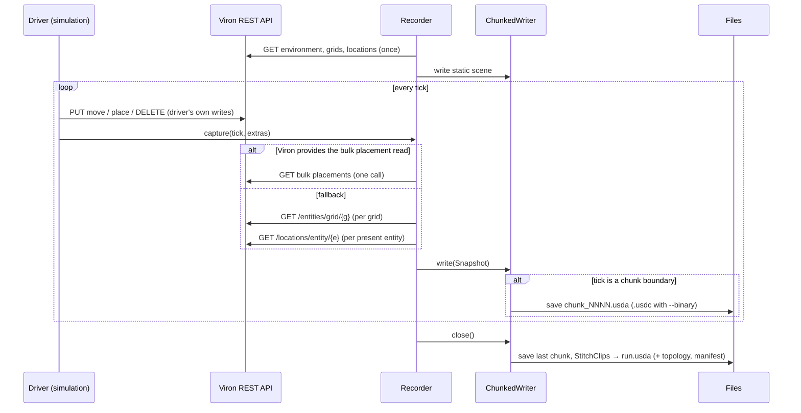

# Architecture — Viron USD

> Status: MVP implemented; this document describes the design as built. Every statement about Viron is cited against
> [`Preponderous-Software/viron@c0a6fc5`](https://github.com/Preponderous-Software/viron/tree/c0a6fc54b66ddab63a9c90f4858fced55ea68e82)
> (`main` on 2026-10-17). `V/` below is shorthand for
> `https://github.com/Preponderous-Software/viron/blob/c0a6fc54b66ddab63a9c90f4858fced55ea68e82/`.
> Statements about USD marked **(spiked)** were checked by a throwaway script against
> `usd-core` 26.8 while writing this document; the script is not part of the repository.

---

## What Viron exposes

### Data model

| Viron concept | Fields returned by the API | Source |
|---|---|---|
| Environment | `environmentId`, `name`, `creationDate` | [`EnvironmentDto.java`](https://github.com/Preponderous-Software/viron/blob/c0a6fc54b66ddab63a9c90f4858fced55ea68e82/src/main/java/preponderous/viron/dto/EnvironmentDto.java) |
| Grid | `gridId`, `rows`, `columns`, `name` (optional) | [`GridDto.java`](https://github.com/Preponderous-Software/viron/blob/c0a6fc54b66ddab63a9c90f4858fced55ea68e82/src/main/java/preponderous/viron/dto/GridDto.java) |
| Location | `locationId`, `x`, `y` — **no grid id** | [`LocationDto.java`](https://github.com/Preponderous-Software/viron/blob/c0a6fc54b66ddab63a9c90f4858fced55ea68e82/src/main/java/preponderous/viron/dto/LocationDto.java) |
| Entity | `entityId`, `name`, `creationDate` — **nothing else** | [`EntityDto.java`](https://github.com/Preponderous-Software/viron/blob/c0a6fc54b66ddab63a9c90f4858fced55ea68e82/src/main/java/preponderous/viron/dto/EntityDto.java) |

Facts the design depends on:

1. **Hierarchy lives in join tables.** `grid_environment`, `location_grid`, and `entity_location`
   link the four tables ([`create_tables.sql`](https://github.com/Preponderous-Software/viron/blob/c0a6fc54b66ddab63a9c90f4858fced55ea68e82/db-scripts/setup/create_tables.sql)).
   A location's grid is therefore only known from *which query returned it*.
2. **One placement per entity.** `entity_location` is keyed on `entity_id` alone
   ([`create_tables.sql` L36-47](https://github.com/Preponderous-Software/viron/blob/c0a6fc54b66ddab63a9c90f4858fced55ea68e82/db-scripts/setup/create_tables.sql#L36-L47)).
   A location may hold several entities.
3. **Entities belong to an environment only through placement.** "Entities in environment" and
   "entities in grid" are subqueries over `entity_location`
   ([`EntityRepositoryImpl.java` L40-52](https://github.com/Preponderous-Software/viron/blob/c0a6fc54b66ddab63a9c90f4858fced55ea68e82/src/main/java/preponderous/viron/repositories/EntityRepositoryImpl.java#L40-L52)).
   An unplaced entity is in the global `/entities/unassigned` pool and is not associated with any
   environment. **Presence** in a recording therefore means "placed in one of this
   environment's grids".
4. **Grid coordinates.** Each grid gets its own locations with `x` in `[0, rows)` and `y` in
   `[0, columns)` ([`EnvironmentFactory.java` L87-94](https://github.com/Preponderous-Software/viron/blob/c0a6fc54b66ddab63a9c90f4858fced55ea68e82/src/main/java/preponderous/viron/factories/EnvironmentFactory.java#L87-L94)).
   Grids in one environment all have the same dimensions and overlapping `(x, y)` ranges; Viron
   defines no spatial relation between grids.
5. **Movement is one step, 8-way.** A move must target a location in the same grid with
   Chebyshev distance 1 ([`LocationController.java` L271-275](https://github.com/Preponderous-Software/viron/blob/c0a6fc54b66ddab63a9c90f4858fced55ea68e82/src/main/java/preponderous/viron/controllers/LocationController.java#L271-L275)).
   Between two recorded ticks, though, a driver may move an entity several times, remove it and
   place it elsewhere, or move it to another grid — the recorder must not assume adjacency.
6. **No time axis.** There is no tick, version, event, or history concept in the API
   ([`docs/openapi/viron-api.json`](https://github.com/Preponderous-Software/viron/blob/c0a6fc54b66ddab63a9c90f4858fced55ea68e82/docs/openapi/viron-api.json)).
   The recorder supplies the time axis.
7. **No pagination, no bulk placement read.** List endpoints return everything
   ([`docs/MVP.md` — pagination listed as optional](https://github.com/Preponderous-Software/viron/blob/c0a6fc54b66ddab63a9c90f4858fced55ea68e82/docs/MVP.md)),
   and there is no single call that returns every entity→location pair for a grid. A read-only
   bulk endpoint has been requested upstream in [Preponderous-Software/viron#234](https://github.com/Preponderous-Software/viron/issues/234) (see [Decisions](#decisions)).
8. **Auth.** Every endpoint except `/actuator/health` and the API docs needs
   `Authorization: Bearer <JWT>`. Tokens are HMAC-signed (HS256/384/512) with the UTF-8 bytes of
   Viron's `JWT_SECRET` and must carry an `iss` matching `JWT_ISSUER`
   ([`SecurityConfig.java` L64-80](https://github.com/Preponderous-Software/viron/blob/c0a6fc54b66ddab63a9c90f4858fced55ea68e82/src/main/java/preponderous/viron/config/SecurityConfig.java#L64-L80),
   [`sample.env`](https://github.com/Preponderous-Software/viron/blob/c0a6fc54b66ddab63a9c90f4858fced55ea68e82/sample.env)).
9. **A Python client already exists** in Viron at `src/main/python/preponderous/viron/`, built on
   `requests` ([`locationService.py`](https://github.com/Preponderous-Software/viron/blob/c0a6fc54b66ddab63a9c90f4858fced55ea68e82/src/main/python/preponderous/viron/services/locationService.py)),
   but it is imported as `src.main.python.preponderous.viron…` from a repository checkout and is
   not packaged ([README § Testing](https://github.com/Preponderous-Software/viron/blob/c0a6fc54b66ddab63a9c90f4858fced55ea68e82/README.md#-testing)).

### Endpoints the recorder uses (all `GET`)

| Endpoint | Returns | Used for | When |
|---|---|---|---|
| `/api/v1/environments/{id}` | `EnvironmentDto` | Root prim metadata | Start of run |
| `/api/v1/grids/environment/{environmentId}` | `GridDto[]` | Grid planes | Start of run, and start of each chunk |
| `/api/v1/locations/grid/{gridId}` | `LocationDto[]` | Cell mesh, location id → (grid, x, y) | Start of run (locations are static) |
| `/api/v1/entities/grid/{gridId}` | `EntityDto[]` | Which entities are present, and their names | Every tick |
| `/api/v1/locations/entity/{entityId}` | `LocationDto` | Where each present entity stands | Every tick, per present entity (fallback) |
| `/api/v1/entities/{id}` | `EntityDto` | Name of a placed entity missing from the name list | Bulk path only, when needed (see [Consistency](#consistency)) |
| Bulk placement read (requested in [Preponderous-Software/viron#234](https://github.com/Preponderous-Software/viron/issues/234); path not yet defined) | Every placed entity's id, grid, environment, `x`, `y` | Replaces the two per-tick rows above | Every tick, **when the Viron instance provides it** |

Endpoint list: [`docs/MVP.md`](https://github.com/Preponderous-Software/viron/blob/c0a6fc54b66ddab63a9c90f4858fced55ea68e82/docs/MVP.md);
the per-grid entity query: [`EntityController.java` L52-56](https://github.com/Preponderous-Software/viron/blob/c0a6fc54b66ddab63a9c90f4858fced55ea68e82/src/main/java/preponderous/viron/controllers/EntityController.java#L52-L56).
The recorder never calls `POST`, `PUT`, `PATCH`, or `DELETE`.

---

## Where the recorder lives

Two options were evaluated.

### Option A — Python client polling Viron's REST API (chosen)

- **USD support is first-class.** Pixar publishes [`usd-core`](https://pypi.org/project/usd-core/)
  on PyPI (26.8, released 2026-07-20, Python `>=3.9,<3.15`). It contains the core USD libraries,
  including `Usd`, `UsdGeom`, `Sdf`, and `UsdUtils.StitchClips` **(spiked)**.
- **Precedent.** Both NVIDIA Warp's `UsdRenderer` and MuJoCo's `USDExporter` record simulations to
  USD from Python on top of `usd-core` (see [CONCEPT.md § Prior art](CONCEPT.md#prior-art)).
- **Viron needs no changes.** Everything the recorder needs is readable over REST (table above).
- **Viron already treats Python as a client language** (fact 9).
- **Cost:** without a bulk endpoint, one HTTP round trip per present entity per tick (see
  [Snapshot cost](#snapshot-cost)), and snapshots can be torn in poll mode (see
  [Consistency](#consistency)). Both go away once Viron provides the bulk read requested in
  [Preponderous-Software/viron#234](https://github.com/Preponderous-Software/viron/issues/234).

### Option B — Java exporter (rejected for the MVP)

- **No official Java bindings.** OpenUSD's README lists "Python Bindings" as its only language-binding component
  ([OpenUSD README](https://github.com/PixarAnimationStudios/OpenUSD/blob/v26.08/README.md)), and
  its build script exposes `--python`/`--no-python` but nothing for Java
  ([`build_usd.py`](https://github.com/PixarAnimationStudios/OpenUSD/blob/v26.08/build_scripts/build_usd.py)).
  A search turned up no maintained Java/JNI binding; an
  [AOUSD forum thread](https://forum.aousd.org/t/openusd-binding-for-multiple-programming-languange/586)
  asking about other-language bindings points to wrapping the C++ API instead.
- Without bindings, a Java exporter would have to either write `.usda` text by hand (no binary
  crate format, no value-clip stitching, no validation through the USD runtime) or maintain a
  JNI layer over the C++ libraries.
- **An in-process exporter would mean changing Viron**, and Viron still would not know where a
  tick ends — tick boundaries belong to the driver, not to Viron (fact 6).
- **What it would gain:** a single consistent database read per tick and no HTTP overhead.
  That benefit is real, and is better obtained by a read-only bulk endpoint in Viron than by a
  Java exporter, and has been requested upstream (see [Decisions](#decisions)).

---

## Components

| Module | Responsibility |
|---|---|
| `client.py` | `VironClient`: thin `requests` wrapper over the `GET` endpoints above, plus the bulk placement read when the Viron instance provides it (probed through `supports_bulk_placements()`, which answers `False` until the endpoint's path and shape are defined; see [Snapshot cost](#snapshot-cost)). Its transport interface has a `get` method only — no HTTP method parameter; bearer token from `--token` or `VIRON_TOKEN`; timeouts and retry on `503` + `Retry-After` (Viron answers lock-wait overruns that way — [README § Database pool and lock wait](https://github.com/Preponderous-Software/viron/blob/c0a6fc54b66ddab63a9c90f4858fced55ea68e82/README.md#database-pool-and-lock-wait)). Its transport is injectable so tests can substitute a fake Viron. |
| `snapshot.py` | `Snapshot` (frozen dataclass): `tick`, `wall_clock`, `entities: dict[entity_id → (name, grid_id, location_id)]`, `extras: dict[entity_id → dict[str, value]]` (empty unless the driver passes extras), `warnings` (torn reads still present after the retry; see [Consistency](#consistency)). `WorldLayout`: grids and `location_id → (grid_id, x, y)`, fetched once. `take_snapshot(client, layout, tick)`; `read_placements(client, layout)` is the one place the bulk read replaces the *G + N* fallback. |
| `mapping.py` | Pure functions: prim paths, grid origin offsets, `cell_center(grid, x, y)`, `entity_offset(entity_id)` (fan-out within a cell), `entity_position(grid, x, y, entity_id)`, entity display colour, extras value → USD type (re-exported from `usd_recorder.values`). No HTTP imports and no stage access, so it is trivially unit-testable. |
| `writer.py` | `TimeSampledWriter`: owns a `Usd.Stage`, writes the static scene once, then `write(snapshot)` per tick using sparse sampling with hold keys (usd-recorder's `Track`; positions, presence, names, and extras); `close()` sets the time range and saves. |
| `chunks.py` | `ChunkedWriter`: rotates to a new `TimeSampledWriter` every `chunk_size` ticks (re-reading the grids), stitches all chunks through usd-recorder's `stitch` (`UsdUtils.StitchClips`, publishing the stitched layers atomically), and authors the manifest defaults. `flatten(run, out)` is usd-recorder's `flatten`. |
| `recorder.py` | `Recorder(client, environment_id, writer)` (or `Recorder.create(client, environment_id, out_dir, …)`, which fetches the layout and opens the writer): `capture(tick, extras=None)` for driven mode (ticks must increase); `run_polling(interval, ticks)` for poll mode (no extras); `close()`. |
| `cli.py` | `viron-usd record …`, `viron-usd flatten …`; both take `--binary` (see [Output format](#output-format)). |

---

## Data flow



In **poll mode** the driver is not involved: the recorder calls `capture(n)` itself every
`--interval` seconds, with `n` counting from 0.

---

## Viron → USD mapping

Stage settings: `upAxis = Z`, `metersPerUnit = 1.0`, one Viron cell = 1 unit. Default prim `/World`.

| Viron | USD prim / attribute | Type | Time-sampled? |
|---|---|---|---|
| Environment *E* | `/World/env_<E>` (`Xform`); `viron:environmentId` (int), `viron:name` (string) | — | No |
| Grid *G* (index *i* within *E*, ordered by `gridId`) | `/World/env_<E>/grids/grid_<G>` (`Xform`), translated to `(i × (rows + gap), 0, 0)`; `viron:gridId`, `viron:rows`, `viron:columns`, `viron:name` | — | No |
| Locations of grid *G* | `/World/env_<E>/grids/grid_<G>/cells` (`Mesh`): one quad face per location, face index `x × columns + y`; `int[] viron:locationIds` maps face index → `locationId` | — | No |
| Entity *e* | `/World/env_<E>/entities/e_<e>` (`Xform`) with child `geom` (`Cube`, size 0.4, `primvars:displayColor` from a hash of the entity id unless the driver supplies `color`) | — | — |
| Entity position | `e_<e>.xformOp:translate` (`double3`) = grid origin + `(x + 0.5 + dx, y + 0.5 + dy, 0.2)`, where `(dx, dy) = entity_offset(e)` (see [Shared cells](#shared-cells)) | `double3` | **Yes** |
| Entity presence | `e_<e>.visibility` = `inherited` when placed in a grid of *E*, else `invisible` | `token` | **Yes** |
| Entity name | `e_<e>.viron:name` | `string` | **Yes** |
| Entity id | `e_<e>.viron:entityId` | `int` | No |
| Driver extra *k* (optional, driven mode only) | `e_<e>.extras:<k>`; the reserved key `color` (RGB triple in `[0, 1]`) is written to `geom.primvars:displayColor` instead (see [Optional per-entity extras](#optional-per-entity-extras)) | `bool` / `int` / `double` / `string` / `double3` (`color3f[]` for `color`) | **Yes** |
| Tick wall-clock time | `/World.viron:wallClock` (seconds since epoch) | `double` | **Yes** |

Notes:

- **2D → 3D.** Viron `x` → USD X, Viron `y` → USD Y, Z is up and every entity sits on the
  `z = 0` plane. Viron does not define which way rows or columns face, so this is a convention,
  documented in the stage's `customLayerData`.
- **Entities are not parented under grids** because an entity can change grid between ticks;
  its grid is folded into its translation instead.
- **Several entities on one location** are fanned out within the cell (see [Shared cells](#shared-cells)).
- **Locations are faces, not prims.** A prim per location would put 10,000 prims on the stage for
  one 100×100 grid, for data that never changes. The face table keeps every location
  addressable by id.

### Shared cells

Viron lets a location hold several entities (fact 2). So that every one of them stays visible,
each entity is drawn at a small offset from the cell centre:

- `entity_offset(e)` is a pure function of the entity id: the first 8 bytes of SHA-256 of the
  decimal id string, read as two unsigned 32-bit integers and scaled to `[-0.25, 0.25]` each.
  It does not use Python's `hash()`, which is not stable for strings across processes.
- The offset is applied to **every** entity, alone in its cell or not, so an entity never jumps
  when others arrive or leave — its position changes only when its own location does.
- With the cube at size 0.4, an offset of at most 0.25 keeps the cube inside its cell
  (`0.5 ± 0.25 ± 0.2` stays within `[0.05, 0.95]`).
- Two entities can still overlap partly if their offsets happen to be close; an exact
  coincidence needs a hash collision on 64 bits.

### Optional per-entity extras

Viron entities carry only id, name, and creation date. In driven mode the driver may pass extra
per-entity values with each tick:

```python
recorder.capture(tick, extras={7: {"color": (0.9, 0.2, 0.1), "category": "wolf"}})
```

- **Optional.** A recording made without `extras` (and every poll-mode recording) contains no
  `extras:*` attributes and is otherwise identical.
- Each key *k* becomes the time-sampled attribute `extras:<k>` on the entity prim, written with
  the same sparse-sampling and hold-key rule as the Viron attributes. A key omitted on a later tick
  keeps its last value; an entity omitted from `extras` keeps all of its values.
- Types: `bool` → `bool`, `int` → `int`, `float` → `double`, `str` → `string`, a sequence of three
  numbers → `double3`. The type of a key must stay the same for an entity across the run; a
  change raises `ValueError`. Keys must be valid USD property names.
- The reserved key `color` (three numbers in `[0, 1]`) is written as a time-sampled
  `primvars:displayColor` on the entity's `geom`, replacing the hash colour from that tick on.
- Extras for an entity that is not placed in the environment at that tick are ignored with a
  warning, since there is no visible prim state to attach them to.

---

## Time-code scheme

- **One tick = one time code.** Tick *n* is written at time code *n*. Ticks are integers and start
  at 0 for the first capture of a run (driven mode may pass any increasing sequence of integers;
  a tick that is not greater than the previous one raises `ValueError`).
- `startTimeCode` / `endTimeCode` = first / last captured tick.
- `timeCodesPerSecond` = `framesPerSecond` = `--ticks-per-second` (default **10**), so one tick
  plays as one frame and a 1,000-tick run plays in 100 seconds.
- Poll mode records the real capture time in `viron:wallClock`, so playback stays evenly spaced
  even if captures were not.

## Sampling strategy

(The sampler described here is `usd_recorder.Track`, shared with other recorders through
[usd-recorder](https://github.com/Preponderous-Software/usd-recorder).)

USD interpolates numeric attributes such as `double3` linearly between authored samples, while
`token` and `string` attributes are held. Writing a sample only when a value changes is
therefore not enough for `translate`: an entity at A for ticks 0–9 that moves to B at tick 10
would appear to drift from A to B across ticks 0–10.

Rule per attribute per entity:

1. On the first tick an entity is seen, write its value.
2. On later ticks, if the value is unchanged, write nothing but remember `(tick, value)` as
   *pending hold*.
3. When the value changes at tick *t*, first write the pending hold at its tick (the last
   unchanged tick, *t − 1* if every tick was captured), then write the new value at *t*.
4. On `close()` (and at the end of each chunk), flush any pending hold so the final value is held
   through the end of the range.

This gives at most two samples per change. Visibility and name follow the same rule; for them
the hold key is harmless and keeps the logic uniform.

Before an entity's first appearance, its `visibility` resolves to `invisible`: within one layer the
writer authors an `invisible` sample at the previous captured tick, which USD holds backwards to the
start of the range; across chunks the manifest default does it (see
[late arrivals](#late-arrivals-in-value-clips)). After its last appearance, the final `invisible` sample is held.

## Snapshot cost

Per tick, for an environment with *G* grids and *N* placed entities:

- **With the bulk placement read** requested in [Preponderous-Software/viron#234](https://github.com/Preponderous-Software/viron/issues/234): **1** `GET`, scoped to the
  environment. `VironClient` checks once at the start of a run whether the Viron instance
  provides it and uses it for every tick if so.
- **Fallback (Viron at `c0a6fc5`):** **G + N** `GET` requests (one `/entities/grid/{g}` per grid,
  one `/locations/entity/{e}` per entity). The alternative, asking each location for its
  entities, costs *rows × columns × G* requests and is only cheaper when the grids are nearly
  full; the client may pick whichever is smaller per grid.

Entity names come from `/entities/grid/{g}` in the fallback path; with the bulk read they come
from one `/entities/environment/{environmentId}` call per tick
([`EntityController.java` L46-50](https://github.com/Preponderous-Software/viron/blob/c0a6fc54b66ddab63a9c90f4858fced55ea68e82/src/main/java/preponderous/viron/controllers/EntityController.java#L46-L50)),
so the bulk path costs 2 requests per tick rather than 1 unless the endpoint also returns names.

Measured in M7 against a real Viron at the pinned commit (fallback path, driven mode, one
capture per tick, timed around `Recorder.capture`):

| Where | Scenario | Mean | p95 | `GET`s per capture |
|---|---|---|---|---|
| Local (Viron jar + PostgreSQL 12 on the same machine, 2026-10-17) | `random_walk.py`, 50 ticks, 8 entities, 1 grid | 21.0 ms | 27.7 ms | 9.1 (= 1 + 8, plus the one-off layout reads) |
| Local (same) | scripted walk, 50 ticks, 7 entities, 2 grids, chunk size 20 | 32.7 ms | 51.5 ms | 2 + *N* |
| CI (GitHub-hosted `ubuntu-latest`, Docker Compose, 2026-10-17) | `random_walk.py`, 50 ticks, 8 entities, 1 grid | 14.6 ms | 19.2 ms | 9.1 |
| CI (same) | scripted walk, 50 ticks, 7 entities, 2 grids, chunk size 20 | 20.2 ms | 30.2 ms | 2 + *N* |

Cost grows with *G + N* as predicted; a few milliseconds per placed entity on a local machine.
The CI job prints these figures on every run (`pytest -m integration -s`).

## Consistency

The `GET`s for one tick are separate requests, not one transaction.

- **Driven mode** (the default for the demo): the driver calls `capture(tick)` after its writes
  for the tick and waits for it to return before continuing, so the snapshot is consistent.
- **Poll mode with the bulk placement read:** every placement comes from one query, so the
  placement map is consistent. Names come from a second call, so a rename or a just-created
  entity's name can lag by one tick; a placed entity missing from the name list is looked up with
  `GET /api/v1/entities/{id}`.
- **Poll mode without it:** the driver keeps writing while the recorder reads, so a snapshot can be torn.
  `take_snapshot` detects the cases it can (an entity listed in grid *g* whose location is not
  in *g*; an entity that `404`s between the two calls), retries the tick once, and otherwise
  records it with a warning in the layer's `customLayerData`.

---

## Layer strategy for long runs

### Chunk layers + value clips

A run is written as fixed-size **chunks** (`--chunk-size`, default 1,000 ticks):

```text
runs/<run-id>/
  run.usda            # root: subLayers topology, clips metadata on /World
  run.topology.usda   # every prim and attribute declaration seen in any chunk
  run.manifest.usda   # attributes with time samples, plus defaults (see below)
  chunk_0000.usda     # ticks    0– 999 (chunk_0000.usdc with --binary)
  chunk_0001.usda     # ticks 1000–1999
  …
```

Each chunk is a self-contained stage holding only that range's samples. After the last chunk,
`UsdUtils.StitchClips(rootLayer, chunkPaths, "/World")` writes `run.usda`, the topology layer,
and the manifest ([Value Clips — `usdstitchclips`](https://openusd.org/release/api/_usd__page__value_clips.html)).
The static scene (grid planes, cell meshes) is written into the topology layer, not repeated
in every chunk.

Why this over one big layer: memory stays bounded during recording (only the current chunk is
open), a crash loses at most one chunk, and USD opens clips on demand when a time is queried.
Why not one file per tick: Blender's importer documents that USD file sequences ("a unique
file per frame") are not supported
([Blender manual — USD](https://docs.blender.org/manual/en/latest/files/import_export/usd.html)),
and each per-tick file would repeat every prim declaration.

### Gotchas found while spiking (spiked, `usd-core` 26.8)

1. **Each chunk must author its own `startTimeCode`/`endTimeCode`.** `StitchClips` derives the
   `active` and `times` metadata from them; without them every clip was stitched as active at
   time 0, USD warned "Clip 1 cannot be active at time 0.000…", and the stage resolved to a
   single frame.
2. <a id="late-arrivals-in-value-clips"></a>**Late arrivals.** An entity first placed in chunk 3
   has no samples in chunks 1–2. When those clips are active, its `visibility` resolved to the
   schema fallback `inherited` — the entity was visible (at the origin) before it existed.
   Authoring `visibility = "invisible"` as a **default on the attribute in the manifest** fixed
   this; the same default authored in the topology layer did not. The OpenUSD docs confirm that
   manifest attributes "may have default values" used during clip value resolution, and that
   defaults in the clip layers themselves are ignored.
3. **The union of prims works.** An entity that exists only in a later chunk still appears in the
   stitched topology.
4. **Flattening bakes clips.** `Usd.Stage.Flatten()` on the stitched stage produced one layer with
   every time sample resolved (30 samples over a 3×10-tick spike) and no clip metadata.
5. **`StitchClips` must be able to open the clip paths it is given.** Passing `./chunk_0000.usda`
   failed to open the layer; passing absolute paths works, and the stitched `run.usda` still
   records them relative to itself (`@./chunk_0000.usda@`), so a run directory stays relocatable.
   (Found while implementing M6.)

Implementation notes (M6): chunk *k* holds ticks `[first + k × chunk_size, first + (k + 1) × chunk_size)`
where *first* is the first tick successfully written (a failed first capture does not anchor
them); a range with no captured tick produces no chunk; the grids are re-read when a new chunk
starts, before that tick's snapshot is taken (and re-tried on the next capture if that read
fails). The re-read is merged into the layout already in use: grids seen earlier keep their index
(so their origins and the positions recorded on them never move, even if a lower-numbered grid is
removed), new grids are appended, and a removed grid keeps its plane in the stitched scene. The
manifest also gets the id-hash colour as the default of any animated `displayColor`. Driver extras (values, types, and the driver colour) are carried into each new chunk and
re-authored when the entity first appears in it, so an omitted key keeps its value and a type
change is still rejected across a chunk boundary.
`viron-usd record` chunks by default (`--chunk-size 1000`); `--chunk-size 0` writes one unchunked
layer (`run.usda`, or `run.usdc` with `--binary`) instead. While an entity is unplaced only its
`visibility` is meaningful: an unchunked layer holds its last position and name, whereas a chunk
recorded entirely while it was unplaced has no samples for it.

### Size

Sparse sampling bounds samples by the number of *changes*, not ticks × entities. Text `.usda`
is the default (see [Output format](#output-format)); `--binary` switches to the `.usdc` crate
format, which stores samples in binary.

Measured on 2026-10-17 with [`benchmarks/stage_size.py`](benchmarks/stage_size.py) (`usd-core`
26.8, Python 3.12) for the fixed scenario: 100 entities on one 50×50 grid, 10,000 ticks, 50 % of
the entities moving to a different neighbouring cell every tick. Sizes are the sum of every file the run leaves on disk;
the chunked rows include `run.usda`, the topology layer, and the manifest.

| Layout | Files | Size | Write time |
|---|---|---|---|
| Unchunked `.usda` | 1 | 54.3 MB (51.8 MiB) | 23 s |
| Chunked (1,000 ticks) `.usda` | 13 | 55.1 MB (52.6 MiB) | 22 s |
| Unchunked `.usdc` (`--binary`) | 1 | 15.5 MB (14.8 MiB) | 15 s |
| Chunked (1,000 ticks) `.usdc` (`--binary`) | 13 | 18.0 MB (17.2 MiB) | 20 s |

Each moving entity costs two translate samples per tick (the hold key and the new value), so
this scenario is close to the worst case for sparse sampling; chunking adds under 2 % in text
and about 16 % in binary (each chunk repeats the prim declarations), and binary is about 3.5×
smaller than text.

### Output format

- Every layer `viron-usd` writes is text **`.usda` by default**.
- `--binary` (on `record` and `flatten`) writes the layers that hold time samples — the chunk
  layers, the single layer of an unchunked recording, and the flattened layer — as **`.usdc`**.
- `run.usda`, `run.topology.usda`, and `run.manifest.usda` stay text either way: they are small
  and hold the clip metadata a reader is most likely to inspect.
- `flatten` writes `run_flat.usda` (or `run_flat.usdc` with `--binary`) unless `-o` is given; an
  explicit `-o` whose extension disagrees with `--binary` is an error rather than a silent
  override.

### Playback targets

| Tool | Reads | Notes |
|---|---|---|
| usdview | `run.usda` directly (value clips are core USD) | usdview is **not** in the `usd-core` wheel ("does not provide any of the optional plugins or imaging features"); it comes from a full OpenUSD build (`build_usd.py`, usdview on by default) or a prebuilt OpenUSD distribution. |
| Blender | `run_flat.usda` (or `.usdc`) from `viron-usd flatten` | Time-varying transforms import as a Transform Cache constraint; prims with animated visibility are always imported ([Blender manual](https://docs.blender.org/manual/en/latest/files/import_export/usd.html)). Checked in M8 with Blender 4.2.23 LTS (`bpy`, headless): entities animate through Transform Cache constraints and the value-clip `run.usda` also imports with the same motion, but animated visibility does **not** play back as hide/show, so unplaced entities stay visible (at the origin in chunks where they have no samples); the frame rate must be set by hand. Details: [docs/PLAYBACK.md](docs/PLAYBACK.md#what-was-checked-in-blender-2026-10-17). |

---

## Dependencies

| Dependency | Version | Why |
|---|---|---|
| Python | `>=3.10` (CI: 3.10, 3.12) | `usd-core` 26.8 supports `>=3.9,<3.15`; 3.9 is past end of life. |
| [`usd-core`](https://pypi.org/project/usd-core/) | `==26.8` (pinned) | USD authoring, crate format, `UsdUtils.StitchClips`. Pinned because value-clip behaviour is what the tests assert. |
| [`usd-recorder`](https://github.com/Preponderous-Software/usd-recorder) | `v0.1.0` (git tag) | The shared recording building blocks: sparse sampling with hold keys (`Track`), extras value typing, atomic `StitchClips` with topology/manifest/root hooks, manifest defaults, and `flatten`. viron-usd keeps its own stage layout, chunk naming and rotation. `tests/test_equivalence.py` compares every output file with golden copies written before the move (byte for byte for text, by text export for `.usdc`). Not on PyPI yet, so it is installed from the tag. |
| [`requests`](https://pypi.org/project/requests/) | `>=2.32` | HTTP; same floor as Viron's own Python client ([`requirements.txt`](https://github.com/Preponderous-Software/viron/blob/c0a6fc54b66ddab63a9c90f4858fced55ea68e82/requirements.txt)). |
| [`pytest`](https://pypi.org/project/pytest/) (dev) | `>=8` | Tests. |
| [`PyJWT`](https://pypi.org/project/PyJWT/) (dev) | `>=2.10` | Minting HS256 test tokens for the integration suite. |
| [`usd-asset-gate`](https://github.com/Preponderous-Software/usd-asset-gate) (CI only) | pinned commit `e8b2853` (`USD_ASSET_GATE_SHA` in `.github/workflows/usd-asset-gate.yml`) | Validates recorded runs in CI (see [Testing strategy](#testing-strategy)). No release tag yet, so a full commit SHA is pinned; not a package dependency. |
| Viron (integration/demo only) | pinned commit `c0a6fc5` (`VIRON_COMMIT` in `tests/integration/start_viron.sh`) | Built from a checkout at that commit and run with [`tests/integration/compose.yml`](tests/integration/compose.yml), which mirrors Viron's own [`compose.yml`](https://github.com/Preponderous-Software/viron/blob/c0a6fc54b66ddab63a9c90f4858fced55ea68e82/compose.yml) (PostgreSQL 12 + the Spring Boot service on port 9999) with a test secret, debug endpoints and usage reporting off, and `stringtype=unspecified` on the JDBC URL (see [Integration finding](#integration-finding-creation-dates)). |

---

## Testing strategy

- **Unit (fast, no network):** `mapping.py` as pure functions; `snapshot.py` and `recorder.py`
  against a **fake Viron transport** — an in-memory world with the same JSON shapes as the DTOs
  above, which raises on any non-`GET` request (acceptance criterion 1). Writer and chunk tests
  feed synthetic `Snapshot`s and assert on the stage through the `pxr` API: resolved
  translation and `ComputeVisibility` at each integer time code, sample counts per attribute, and
  equality between chunked, unchunked, and flattened stages.
- **Integration (marked `integration`, separate CI job):** `tests/integration/start_viron.sh`
  clones Viron at the pinned commit and starts it with Docker Compose (`VIRON_DEBUG_ENABLED=false`,
  usage reporting off, a test `JWT_SECRET`); the suite mints an HS256 token with PyJWT, refuses any
  `VIRON_URL` that is not `localhost`, runs `examples/random_walk.py` for 50 ticks plus a scripted
  walk (a frozen entity, a paused entity, a late arrival, a removal, a rename), and asserts
  criteria 1–5 on the output. The recorder's HTTP session fails the test on any non-`GET` request.
- **USD asset gate (separate CI workflow, `.github/workflows/usd-asset-gate.yml`):** starts the
  same throwaway Viron, records two runs with `examples/random_walk.py` (30 ticks in 10-tick
  value-clip chunks, and 10 ticks as a single binary layer), flattens the chunked one, and runs
  `usd-asset-gate check` on all of them. Its rules live in `.usd-asset-gate.yml`: OpenUSD's
  validators plus `metersPerUnit = 1`, `upAxis = Z`, and a 10 MB file-size cap, failing on
  warnings; `run.manifest.usda` is exempt from the default-prim and stage-metadata checks because
  it is only composed through `run.usda`'s clip metadata.
- **Manual (documented in M8):** open the demo run in usdview and Blender and check that
  playback looks right.

#### Integration finding: creation dates

Against the stock schema, `POST /api/v1/environments` on Viron at the pinned commit answered
`400 Failed to create environment`: the factory binds `new java.util.Date().toString()` as a string
([`EnvironmentFactory.java` L52-54](https://github.com/Preponderous-Software/viron/blob/c0a6fc54b66ddab63a9c90f4858fced55ea68e82/src/main/java/preponderous/viron/factories/EnvironmentFactory.java#L52-L54))
into a `TIMESTAMP NOT NULL` column ([`create_tables.sql` L29-34](https://github.com/Preponderous-Software/viron/blob/c0a6fc54b66ddab63a9c90f4858fced55ea68e82/db-scripts/setup/create_tables.sql#L29-L34)),
and PostgreSQL rejects a `character varying` value there. The test instance adds
`?stringtype=unspecified` to its JDBC URL, which lets PostgreSQL parse the string as a timestamp.
This affects only the driver's writes, not the recorder's reads, and no change to Viron is made
from this project.

---

## Decisions

Recorded 2026-10-17. Each resolves a former open question.

1. **Bulk placement read in Viron — requested upstream.** A read-only endpoint returning every
   placed entity's location (entity id, grid, environment, `x`, `y`) in one call, optionally
   scoped to an environment, was filed as [Preponderous-Software/viron#234](https://github.com/Preponderous-Software/viron/issues/234). The recorder uses it when the Viron
   instance provides it and falls back to *G + N* requests otherwise
   (see [Snapshot cost](#snapshot-cost) and [Consistency](#consistency)).
2. **Visual state beyond position — optional driver extras.** `capture(tick, extras={entity_id: {...}})`
   writes custom time-sampled attributes (e.g. colour, category); recordings made from Viron
   alone work without it (see [Optional per-entity extras](#optional-per-entity-extras)).
3. **Several entities on one location — fan out within the cell**, using small deterministic
   offsets that are stable per entity id, so every entity stays visible
   (see [Shared cells](#shared-cells)).
4. **Packaging — git only for now.** `viron-usd` is installed from a git checkout; it is not
   published to PyPI.
5. **Output format — `.usda` by default, `--binary` for `.usdc`**
   (see [Output format](#output-format)).

---

## Open questions

1. **Grid layout.** Side by side along X (MVP), or a square-ish tiling for environments with many
   grids?
2. **Location prims.** Is a prim per location wanted for small grids (e.g. to attach per-location
   data later), or is the face table sufficient?
3. **Occupancy colouring.** Time-sampled per-face `displayColor` on the cell mesh would show
   occupancy at a glance. Worth adding after the MVP?
4. **Grids and entities changing mid-run.** Grids are re-read at each chunk boundary; a grid
   created mid-chunk appears from the next chunk. Is that granularity enough?
